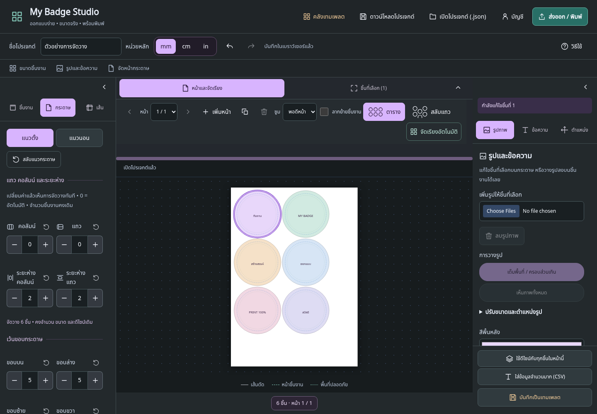

# 🎨 My Badge Studio

ออกแบบเข็มกลัด แม่เหล็ก และสติกเกอร์ — จัดวางบนกระดาษ แล้วส่งออกไปผลิตได้ในที่เดียว

เริ่มจากชิ้นเดียว ปรับดีไซน์ให้ลงตัว แล้วใช้กับหลายชิ้นพร้อมกันได้ ✨



[📱 ดูภาพมือถือและตัวแก้ไขดีไซน์](docs/screenshots/README.md) · [⚡ คู่มือย่อ](file_README.md) · [✅ สถานะการตรวจสอบ](docs/STATUS.md)

---

## 🚀 เริ่มใช้งาน

เลือกวิธีที่สะดวกได้เลย:

| วิธี                   | เหมาะกับใคร                                         |
| ---------------------- | --------------------------------------------------- |
| 📄 **HTML ไฟล์เดียว**  | อยากเปิดใช้งานทันที โดยไม่ติดตั้งโปรเจกต์           |
| 💻 **รันผ่าน Node.js** | ต้องการพัฒนาต่อ หรือใช้ความสามารถของรุ่นเซิร์ฟเวอร์ |

### เปิดแบบไฟล์เดียว

เปิดไฟล์ `portable/My-Badge-Studio.html` ในเบราว์เซอร์

> [!NOTE]
> รุ่นไฟล์เดียวใช้งานออกแบบได้ออฟไลน์ ส่วน PDF ใช้หน้าต่างพิมพ์ของเบราว์เซอร์ แล้วเลือกบันทึกเป็น PDF

### รันโปรเจกต์

ใช้ **Node.js 24 ขึ้นไป** แล้วรัน:

```bash
npm ci
npm run dev
```

เปิด **http://localhost:5173**

---

## 🧭 เครื่องมือแต่ละส่วนอยู่ตรงไหน?

| พื้นที่                 | ใช้ทำอะไร                                          |
| ----------------------- | -------------------------------------------------- |
| ⬅️ **แผงซ้าย**          | เลือกประเภท ขนาด กระดาษ ระยะห่าง และเส้นช่วยออกแบบ |
| 🖼️ **แคนวาสกลาง**       | ดูตำแหน่ง เลือกชิ้นงาน และตรวจการจัดวาง            |
| ➡️ **แผงขวา**           | ปรับภาพ ข้อความ สี และตำแหน่งของชิ้นที่เลือก       |
| 🔝 **เครื่องมือด้านบน** | เปลี่ยนหน้า ซูม และจัดเรียงอัตโนมัติ               |

ลากขอบแผงเพื่อปรับพื้นที่ทำงาน หรือกดลูกศรเพื่อย่อแผงเมื่ออยากเห็นกระดาษมากขึ้น

---

## ✨ ออกแบบชิ้นแรกใน 4 ขั้นตอน

1. **เลือกประเภทและขนาด** ให้ตรงกับชิ้นงานและแม่พิมพ์จริง
2. **คลิกชิ้นงานบนกระดาษ** แล้วกดไอคอนดินสอเพื่อเปิดตัวแก้ไขดีไซน์
3. **เพิ่มรูป ข้อความ และสี** ลากภาพเพื่อเลื่อนตำแหน่ง หรือเลื่อนเมาส์เพื่อซูมภาพ
4. **บันทึกและปิด** เพื่อกลับมาจัดวางบนกระดาษ

ในตัวแก้ไขมีแท็บ **เทมเพลต · รูปภาพ · ข้อความ · สีและเส้น · เลเยอร์**

> [!TIP]
> เปิดกริดเมื่อต้องการจัดแนวให้แม่นขึ้น กริดเป็นเพียงตัวช่วยบนหน้าจอและไม่ถูกส่งออกไปในงานผลิต

---

## 🖱️ แก้หลายชิ้นพร้อมกัน

ไม่ต้องปรับทีละชิ้น:

- **ลากคลุม** เพื่อเลือกหลายชิ้น
- **Shift + คลิก** เพื่อเลือกเพิ่มหรือยกเลิกทีละชิ้น
- **เลือกทั้งหมด** เพื่อเลือกทุกชิ้นในหน้าปัจจุบัน

เมื่อเลือกหลายชิ้น การปรับรูป ข้อความ สี และค่าที่รองรับการแก้แบบกลุ่มจะมีผลกับทุกชิ้นที่เลือก

เลือกภาพหนึ่งไฟล์เพื่อใช้กับทั้งกลุ่ม หรือเลือกหลายไฟล์เพื่อวนใช้ตามลำดับชิ้นงาน

> [!NOTE]
> เลเยอร์ข้อความจับคู่ตามลำดับเลเยอร์ หากชิ้นงานปลายทางไม่มีเลเยอร์นั้น ระบบจะสร้างให้เมื่อแก้ไขค่าที่เกี่ยวข้อง

---

## 📐 จัดแถว คอลัมน์ และระยะห่าง

เปลี่ยนค่าแล้วดูตำแหน่งบนกระดาษได้ทันที หรือกด **จัดเรียงอัตโนมัติ** เพื่อจัดวางใหม่ตามค่าปัจจุบัน

| การตั้งค่า          | ความหมาย                     |
| ------------------- | ---------------------------- |
| **คอลัมน์**         | จำนวนช่องในแนวนอน            |
| **แถว**             | จำนวนช่องในแนวตั้ง           |
| **ระยะห่างคอลัมน์** | ช่องว่างระหว่างชิ้นในแนวนอน  |
| **ระยะห่างแถว**     | ช่องว่างระหว่างชิ้นในแนวตั้ง |
| **0**               | ให้ระบบคำนวณอัตโนมัติ        |

**ตัวอย่าง:** ชิ้นงานขนาดตัด 50 mm จำนวน 6 ชิ้นบน A4  
ตั้งคอลัมน์เป็น **3**, แถวเป็น **0**, ระยะห่างเป็น **2 mm** เพื่อจัดเป็น 3 คอลัมน์ × 2 แถว

> [!IMPORTANT]
> การจัดเรียงคงจำนวน ขนาดจริง และดีไซน์ของชิ้นงานเดิม ไม่สร้างชิ้นเพิ่มหรือย่อให้พอดีกระดาษ หากต้องการจำนวนเพิ่ม ให้ใช้เพิ่มชิ้นงานหรือทำสำเนาก่อน

หากพื้นที่ไม่พอ ระบบจะแจ้งเตือนและคงตำแหน่งที่ยืนยันล่าสุดไว้

↺ ไอคอนข้างแต่ละช่องใช้คืนค่าเริ่มต้น เช่น ระยะห่าง **2 mm** หรือแถว/คอลัมน์ **0**

[อ่านรายละเอียดการจัดวาง](docs/arrangement-controls-spec.md)

---

## 📚 โปรเจกต์กับเทมเพลตต่างกันอย่างไร?

| สิ่งที่ต้องการ               | เครื่องมือ                             |
| ---------------------------- | -------------------------------------- |
| เก็บไฟล์สำรองหรือย้ายเครื่อง | **ดาวน์โหลดโปรเจกต์** เป็นไฟล์ `.json` |
| เปิดไฟล์กลับมาแก้ต่อ         | **เปิดโปรเจกต์ (.json)**               |
| เก็บงานเป็นต้นแบบไว้ใช้ซ้ำ   | **บันทึกเป็นเทมเพลต**                  |
| เก็บเฉพาะรูปแบบการจัดหน้า    | บันทึกเลย์เอาต์                        |
| เตรียมไฟล์สำหรับผลิต         | **ส่งออก / พิมพ์**                     |

คลังเทมเพลตแยกเป็นสองส่วน:

- 🎨 **แกลเลอรีดีไซน์** — เก็บงานออกแบบและโปรเจกต์ไว้ใช้ซ้ำ
- 📐 **แกลเลอรีเลย์เอาต์** — เก็บการจัดวางโดยไม่มีภาพและข้อความ

กด **+** เพื่อเพิ่มรายการ หรือกดไอคอนดินสอเพื่อแก้ไขชื่อ สี และเนื้อหา เมื่ออยู่ในโหมดแก้ไข ระบบจะแสดงชื่อเทมเพลตที่กำลังทำงานอยู่

> [!WARNING]
> เทมเพลตและงานที่บันทึกอัตโนมัติอยู่ในเบราว์เซอร์และอุปกรณ์นี้ การล้างข้อมูลเบราว์เซอร์อาจทำให้ข้อมูลหาย ควรดาวน์โหลดไฟล์โปรเจกต์สำรองไว้ด้วย

---

## ⌨️ คีย์ลัดที่ใช้บ่อย

บน macOS ใช้ **Cmd** แทน **Ctrl**

| คีย์ลัด                 | การทำงาน                                   |
| ----------------------- | ------------------------------------------ |
| `E`                     | เปิดตัวแก้ไขดีไซน์จากแคนวาส                |
| `Ctrl + A`              | เลือกทุกชิ้นในหน้า                         |
| `Ctrl + D`              | ทำสำเนาชิ้นที่เลือก                        |
| `Delete` / `Backspace`  | ขอการยืนยันก่อนลบชิ้นที่เลือก              |
| `Ctrl + Shift + Delete` | ลบเฉพาะภาพ โดยเก็บชิ้นงานไว้               |
| `Ctrl + Shift + S`      | เปลี่ยนเป็นแม่เหล็กสี่เหลี่ยม              |
| `Ctrl + Shift + C`      | เปลี่ยนเป็นเข็มกลัดวงกลม                   |
| `Ctrl + เลื่อนเมาส์`    | ซูมแคนวาสจัดหน้า                           |
| `Ctrl + Z`              | ย้อนกลับ                                   |
| `Ctrl + Shift + Z`      | ทำซ้ำ                                      |
| `Esc`                   | ยกเลิกการเลือก หรือยกเลิกหน้าต่างที่รองรับ |

คีย์ลัดชิ้นงานจะไม่แทรกการพิมพ์ในช่องข้อมูลหรือทำงานขณะเปิดหน้าต่างแก้ไข

---

## 🖨️ ก่อนส่งผลิต

- ตรวจขนาดหน้าและขนาดตัดให้ตรงกับแม่พิมพ์
- แก้คำเตือนชิ้นงานทับกันหรือเกินพื้นที่
- ตรวจภาพและข้อความให้อยู่ในพื้นที่ปลอดภัย
- พิมพ์ที่ **Actual size / 100%** และปิด **Fit to page**
- วัดชิ้นงานทดสอบก่อนผลิตจำนวนมาก

> [!TIP]
> ขนาดที่เห็นบนจอขึ้นอยู่กับการซูมและอุปกรณ์ ให้ใช้ขนาดจริงในไฟล์ส่งออกและงานพิมพ์ทดสอบเป็นตัวตรวจสอบ

---

## 🛠️ สำหรับนักพัฒนา

```bash
# ทดสอบตรรกะและข้อมูล
npm test

# ทดสอบการใช้งานผ่านเบราว์เซอร์
npm run test:e2e

# ทดสอบการจัดวางแบบเรียลไทม์และปุ่มคืนค่า
npm run test:layout

# สร้าง HTML ไฟล์เดียว
npm run build:portable

# ทดสอบรุ่นไฟล์เดียว
npm run test:portable

# ตรวจรูปแบบโค้ด
npm run format:check
```

ดูชุดทดสอบเพิ่มเติมได้ใน `package.json`  
ชุดทดสอบเบราว์เซอร์ต้องมี Chromium พร้อมใช้งาน ดูวิธีตั้ง `CHROMIUM_PATH` และตัวแปรเซิร์ฟเวอร์ใน [คู่มือ deploy](docs/DEPLOYMENT.md)

```bash
npm run test:all          # ทดสอบครบทุกชุด
npm run docs:screenshots  # ถ่ายภาพเอกสารใหม่
npm run verify:release   # ตรวจ source / HTML / ภาพ / ลิงก์
```

สคริปต์ภาพเปิดเซิร์ฟเวอร์และฐานข้อมูลชั่วคราว ไม่ใช้โปรไฟล์ผู้ใช้ ดู [บันทึกการตรวจ repository](docs/RELEASE-AUDIT.md)

---

## 🙌 เครดิต

- แนวทางออกแบบจาก **Impeccable** — ดูใบอนุญาตและประกาศใน `.agents/skills/impeccable/`
- ไอคอนตารางจาก [Flaticon UIcons](https://www.flaticon.com/uicons) — ดู `assets/licenses/Flaticon-LICENSE.txt`

**ออกแบบให้ชัด จัดวางให้พอดี แล้วพิมพ์ทดสอบก่อนผลิตจริง 🎯**
